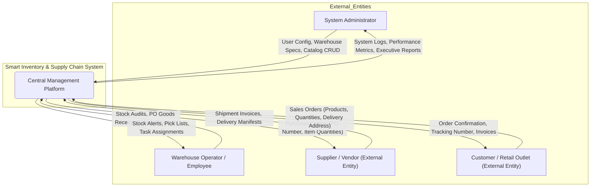
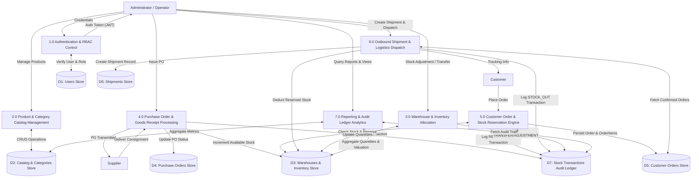
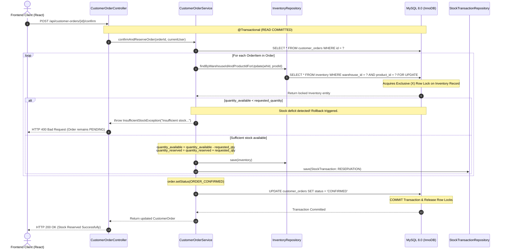
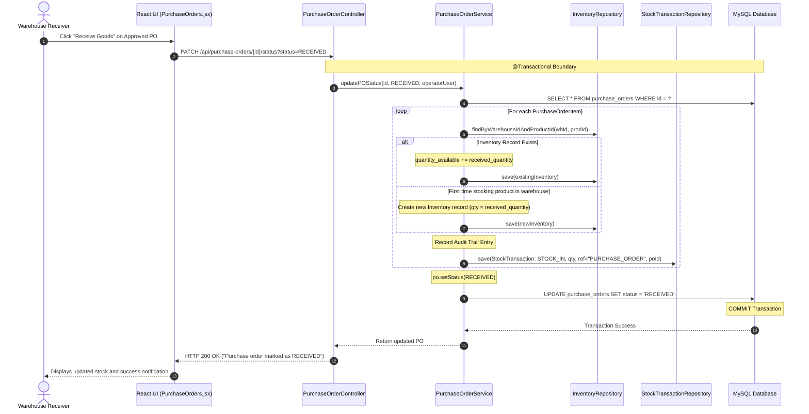

# Smart Inventory and Supply Chain Management System
## Data Flow Diagrams (DFD) & UML Sequence Diagrams

---

### 1. Data Flow Diagram (DFD) Level 0 — Context Level Diagram

The Level 0 DFD illustrates the overall system boundaries, external entities interacting with the platform, and primary bidirectional data flows.

---

### 2. Data Flow Diagram (DFD) Level 1 — Process Decomposition

The Level 1 DFD decomposes the system into discrete operational sub-processes interacting with the database data stores.

---

### 3. UML Sequence Diagram: Customer Order Stock Reservation (ACID Locking)

This sequence diagram illustrates the pessimistic locking flow preventing race conditions and overselling during simultaneous checkout attempts.

---

### 4. UML Sequence Diagram: Purchase Order Goods Receipt (Stock-In)

This sequence diagram outlines the receiving of supplier consignments and updating warehouse inventory.

