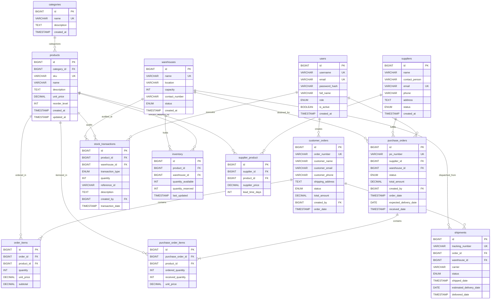
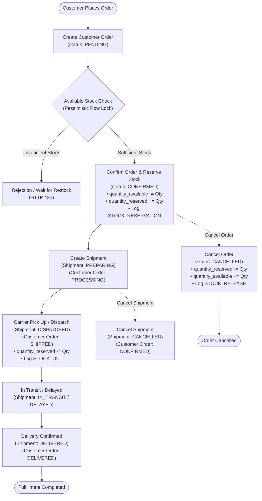
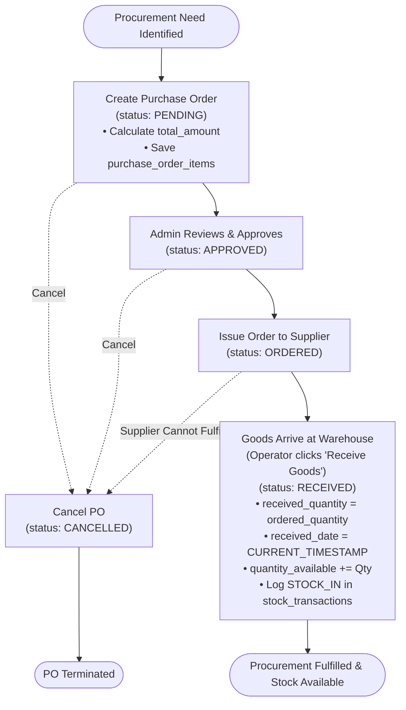

# Smart Inventory & Supply Chain Management System
## Entity-Relationship Diagram and Process Flowcharts

---

## 1. Database Entity-Relationship Diagram (ERD)

---

## 2. Plain-English Description of Every Relationship

1. **`users` -> `purchase_orders` (1:N)**:
   - One user (creator) can author many purchase orders.
   - Each purchase order records the exact employee or admin who generated it (`created_by`).
   - If a user is referenced in purchase orders, deleting the user is prevented (`ON DELETE RESTRICT`).

2. **`users` -> `customer_orders` (1:N)**:
   - One user can register multiple customer sales orders.
   - Each customer order records the operator ID in `created_by`. Deleting the user is prevented (`ON DELETE RESTRICT`).

3. **`users` -> `stock_transactions` (1:N)**:
   - One user can execute multiple inventory modifications.
   - Every immutable stock transaction audit log links directly to the responsible user account in `created_by`.

4. **`categories` -> `products` (1:N)**:
   - One category groups zero, one, or many products.
   - Every product points to its parent category via `category_id`.
   - Categories containing products cannot be deleted (`ON DELETE RESTRICT`).

5. **`products` -> `inventory` (1:N) & `warehouses` -> `inventory` (1:N)**:
   - A single product can be distributed across multiple warehouses.
   - A single warehouse stores inventory records for multiple products.
   - The `inventory` table acts as the composite balance entity, with a unique constraint on `(product_id, warehouse_id)`.
   - Deleting a product or warehouse cascades to delete its balance record (`ON DELETE CASCADE`).

6. **`suppliers` <-> `products` (M:N via `supplier_product`)**:
   - One supplier can supply multiple products at agreed contractual prices.
   - One product can be sourced from multiple competing suppliers.
   - `supplier_product` is the junction table that stores `supplier_price` and `lead_time_days` for the unique pair `(supplier_id, product_id)`.

7. **`suppliers` -> `purchase_orders` (1:N)**:
   - One supplier can receive many purchase orders over time.
   - Deleting an active supplier that has existing purchase orders is prohibited (`ON DELETE RESTRICT`).

8. **`warehouses` -> `purchase_orders` (1:N)**:
   - One warehouse serves as the destination receiving facility for multiple purchase orders (`warehouse_id`).

9. **`purchase_orders` -> `purchase_order_items` (1:N)**:
   - One purchase order contains one or more line items detailing goods ordered.
   - Deleting a purchase order cascades to delete all its line item rows (`ON DELETE CASCADE`).

10. **`products` -> `purchase_order_items` (1:N)**:
    - A product can appear as a line item across multiple purchase orders.
    - Products referenced in procurement history cannot be deleted (`ON DELETE RESTRICT`).

11. **`customer_orders` -> `order_items` (1:N)**:
    - One customer sales order contains one or more individual product line items.
    - Deleting the parent customer order cascades to delete all child line items (`ON DELETE CASCADE`).

12. **`products` -> `order_items` (1:N)**:
    - A product can be purchased across many different customer orders.
    - Products with sales order history cannot be deleted from the catalog (`ON DELETE RESTRICT`).

13. **`customer_orders` -> `shipments` (1:N)**:
    - One customer order is fulfilled through a shipment dispatch record (`order_id`).

14. **`warehouses` -> `shipments` (1:N)**:
    - One warehouse acts as the dispatch origin point for multiple carrier shipments (`warehouse_id`).

15. **`products` -> `stock_transactions` (1:N) & `warehouses` -> `stock_transactions` (1:N)**:
    - Every stock adjustment, transfer, receipt, reservation, or release writes an audit entry recording the `product_id` and `warehouse_id`.

---

## 3. Order Lifecycle Flowchart (Customer Order & Shipment)

---

## 4. Purchase Order Procurement Lifecycle Flowchart

