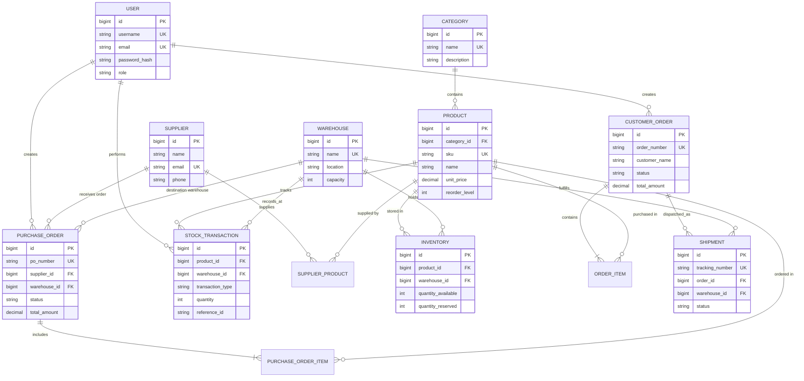

# Phase 1: System Design and Relational Architecture Documentation
**Project Title:** Smart Inventory and Supply Chain Management System  
**Academic Level:** B.Tech Major Project (Focus: Database Management Systems & System Design)

---

## 1. Problem Statement
Modern businesses struggle with disconnected inventory control, uncoordinated supply chain activities, and lack of real-time visibility into warehouse stock levels. Traditional spreadsheet-based or siloed inventory tracking leads to:
- Stockouts of high-demand items and overstocking of low-demand products.
- Double-allocation of stock to multiple customer orders without real-time reservation.
- Inaccurate tracking of purchase orders and delayed replenishment.
- Absence of an immutable audit trail for stock movements (stock in, stock out, transfers, reservations, and adjustments).
- Lack of role-based security separating warehouse employees from organizational administrators.

The **Smart Inventory and Supply Chain Management System** solves these challenges by providing a centralized, three-tier enterprise web application backed by a normalized relational database (MySQL), a robust Java Spring Boot application layer enforcing ACID transaction integrity, and an intuitive, real-time React dashboard.

---

## 2. Requirements Specification

### 2.1 Functional Requirements
1. **User Authentication & RBAC**:
   - Secure login/logout using BCrypt password encryption and JWT authentication.
   - Dual-role permissions: `ADMIN` (Full administrative & CRUD privileges) and `EMPLOYEE` (Order tracking, stock updates, shipment updates).
2. **Product & Category Management**:
   - Manage categories with hierarchical grouping.
   - Maintain product records (SKU, name, category, unit price, reorder level).
   - Real-time stock status flags (Normal, Low Stock, Out of Stock).
3. **Supplier & Warehouse Management**:
   - Maintain supplier directory with pricing and lead times per product (M:N mapping).
   - Multi-warehouse support with capacity tracking and distributed stock levels.
4. **Inventory & Stock Tracking**:
   - Track available vs. reserved inventory per warehouse.
   - Real-time stock level monitoring with low-stock alerts when `quantity_available <= reorder_level`.
5. **Purchase Order (PO) Lifecycle**:
   - Create multi-item purchase orders for selected suppliers.
   - Status pipeline: `PENDING` -> `APPROVED` -> `ORDERED` -> `PARTIALLY_RECEIVED` -> `RECEIVED` / `CANCELLED`.
   - On receiving items, automatically increment warehouse stock and log immutable stock transactions.
6. **Customer Order Lifecycle**:
   - Process multi-item customer orders with real-time stock availability verification.
   - Status pipeline: `PENDING` -> `CONFIRMED` -> `PROCESSING` -> `SHIPPED` -> `DELIVERED` / `CANCELLED`.
   - Atomic reservation of stock upon confirmation; rollback if stock is insufficient.
7. **Shipment Management**:
   - Dispatch customer orders from designated warehouses.
   - Assign carriers, tracking numbers, estimated and actual delivery dates.
8. **Stock Transaction Audit Trail**:
   - Every physical and logical stock movement records an immutable entry in `stock_transactions`:
     - `STOCK_IN` (PO receipt, restocking)
     - `STOCK_OUT` (Order fulfillment)
     - `STOCK_TRANSFER` (Inter-warehouse movement)
     - `STOCK_ADJUSTMENT` (Damage/audit reconciliation)
     - `STOCK_RESERVATION` (Pending order confirmation)
     - `STOCK_RELEASE` (Order cancellation)
9. **Dashboard & Analytics**:
   - Real-time KPI summaries: Total Products, Total Suppliers, Active Warehouses, Total Inventory, Low Stock Count, Pending POs, Pending Orders, In-Transit Shipments.
   - Interactive charts for stock movements, category distribution, and order status.

### 2.2 Non-Functional Requirements
- **Data Integrity & Consistency (ACID)**: Critical stock updates must execute within explicit database transactions with rollback on failure.
- **Security**: Role-Based Access Control (RBAC), password hashing via BCrypt, and input sanitization to eliminate SQL injection and XSS.
- **Performance & Indexing**: Foreign keys, search terms (SKU, PO number, Order number), and frequently filtered columns are indexed for sub-100ms response times.
- **Maintainability & Clean Architecture**: Strict separation of concerns across Presentation (React), Application (Spring Boot), and Database (MySQL) layers.

---

## 3. Entity-Attribute Catalog

| Entity | Primary Key | Attributes | Foreign Keys / Relationships |
| :--- | :--- | :--- | :--- |
| **USER** | `id` | username, email, password_hash, full_name, role, is_active, created_at | None |
| **CATEGORY** | `id` | name, description, created_at | None |
| **PRODUCT** | `id` | sku, name, description, unit_price, reorder_level, created_at, updated_at | `category_id` -> CATEGORY(id) |
| **SUPPLIER** | `id` | name, contact_person, email, phone, address, status, created_at | None |
| **WAREHOUSE** | `id` | name, location, capacity, contact_number, status, created_at | None |
| **INVENTORY** | `id` | quantity_available, quantity_reserved, last_updated | `product_id` -> PRODUCT(id), `warehouse_id` -> WAREHOUSE(id) |
| **SUPPLIER_PRODUCT** | `id` | supplier_price, lead_time_days | `supplier_id` -> SUPPLIER(id), `product_id` -> PRODUCT(id) |
| **PURCHASE_ORDER** | `id` | po_number, status, total_amount, order_date, expected_delivery_date, received_date | `supplier_id` -> SUPPLIER(id), `warehouse_id` -> WAREHOUSE(id), `created_by` -> USER(id) |
| **PURCHASE_ORDER_ITEM** | `id` | ordered_quantity, received_quantity, unit_price | `purchase_order_id` -> PURCHASE_ORDER(id), `product_id` -> PRODUCT(id) |
| **CUSTOMER_ORDER** | `id` | order_number, customer_name, customer_email, customer_phone, shipping_address, status, total_amount, order_date | `created_by` -> USER(id) |
| **ORDER_ITEM** | `id` | quantity, unit_price, subtotal | `order_id` -> CUSTOMER_ORDER(id), `product_id` -> PRODUCT(id) |
| **SHIPMENT** | `id` | tracking_number, carrier, status, shipped_date, estimated_delivery_date, delivered_date | `order_id` -> CUSTOMER_ORDER(id), `warehouse_id` -> WAREHOUSE(id) |
| **STOCK_TRANSACTION** | `id` | transaction_type, quantity, reference_id, description, transaction_date | `product_id` -> PRODUCT(id), `warehouse_id` -> WAREHOUSE(id), `created_by` -> USER(id) |

---

## 4. Entity Relationship Diagram (ERD)

---

## 5. Relational Schema Representation

- **USER** (`id`, `username`, `email`, `password_hash`, `full_name`, `role`, `is_active`, `created_at`)
- **CATEGORY** (`id`, `name`, `description`, `created_at`)
- **PRODUCT** (`id`, `category_id`, `sku`, `name`, `description`, `unit_price`, `reorder_level`, `created_at`, `updated_at`)  
  *FK: category_id REFERENCES CATEGORY(id)*
- **SUPPLIER** (`id`, `name`, `contact_person`, `email`, `phone`, `address`, `status`, `created_at`)
- **WAREHOUSE** (`id`, `name`, `location`, `capacity`, `contact_number`, `status`, `created_at`)
- **INVENTORY** (`id`, `product_id`, `warehouse_id`, `quantity_available`, `quantity_reserved`, `last_updated`)  
  *FK: product_id REFERENCES PRODUCT(id), warehouse_id REFERENCES WAREHOUSE(id)*  
  *UNIQUE(product_id, warehouse_id)*
- **SUPPLIER_PRODUCT** (`id`, `supplier_id`, `product_id`, `supplier_price`, `lead_time_days`)  
  *FK: supplier_id REFERENCES SUPPLIER(id), product_id REFERENCES PRODUCT(id)*  
  *UNIQUE(supplier_id, product_id)*
- **PURCHASE_ORDER** (`id`, `po_number`, `supplier_id`, `warehouse_id`, `status`, `total_amount`, `created_by`, `order_date`, `expected_delivery_date`, `received_date`)  
  *FK: supplier_id REFERENCES SUPPLIER(id), warehouse_id REFERENCES WAREHOUSE(id), created_by REFERENCES USER(id)*
- **PURCHASE_ORDER_ITEM** (`id`, `purchase_order_id`, `product_id`, `ordered_quantity`, `received_quantity`, `unit_price`)  
  *FK: purchase_order_id REFERENCES PURCHASE_ORDER(id), product_id REFERENCES PRODUCT(id)*
- **CUSTOMER_ORDER** (`id`, `order_number`, `customer_name`, `customer_email`, `customer_phone`, `shipping_address`, `status`, `total_amount`, `created_by`, `order_date`)  
  *FK: created_by REFERENCES USER(id)*
- **ORDER_ITEM** (`id`, `order_id`, `product_id`, `quantity`, `unit_price`, `subtotal`)  
  *FK: order_id REFERENCES CUSTOMER_ORDER(id), product_id REFERENCES PRODUCT(id)*
- **SHIPMENT** (`id`, `tracking_number`, `order_id`, `warehouse_id`, `carrier`, `status`, `shipped_date`, `estimated_delivery_date`, `delivered_date`)  
  *FK: order_id REFERENCES CUSTOMER_ORDER(id), warehouse_id REFERENCES WAREHOUSE(id)*
- **STOCK_TRANSACTION** (`id`, `product_id`, `warehouse_id`, `transaction_type`, `quantity`, `reference_id`, `description`, `created_by`, `transaction_date`)  
  *FK: product_id REFERENCES PRODUCT(id), warehouse_id REFERENCES WAREHOUSE(id), created_by REFERENCES USER(id)*

---

## 6. Normalization Analysis (Up to 3NF)

### 6.1 First Normal Form (1NF)
A relation $R$ is in 1NF if and only if all underlying domains contain only atomic (indivisible) values, and there are no repeating groups.
- **Decomposition**: Instead of storing comma-separated lists of items in `CUSTOMER_ORDER` or `PURCHASE_ORDER`, child tables `ORDER_ITEM` and `PURCHASE_ORDER_ITEM` are created.
- **Atomicity**: Each field (`unit_price`, `quantity`, `sku`) contains exactly one scalar value.

### 6.2 Second Normal Form (2NF)
A relation $R$ is in 2NF if and only if it is in 1NF and every non-prime attribute is fully functionally dependent on the candidate key (no partial dependencies).
- **Proof**: In composite entities like `SUPPLIER_PRODUCT`, attributes such as `supplier_price` and `lead_time_days` depend on the composite key $\{supplier\_id, product\_id\}$. Neither depends solely on $supplier\_id$ nor $product\_id$.
- In `ORDER_ITEM`, the non-key attributes $\{quantity, unit\_price, subtotal\}$ depend on the specific order item context $\{order\_id, product\_id\}$, not just $order\_id$.

### 6.3 Third Normal Form (3NF)
A relation $R$ is in 3NF if and only if it is in 2NF and there is no transitive dependency ($X \to Y$ and $Y \to Z$ where $Z$ is a non-prime attribute and $Y$ is not a superkey).
- **Transitive Avoidance**:
  - In `PRODUCT`: We store only `category_id`. We do **not** store `category_name` or `category_description` in `PRODUCT`. $product\_id \to category\_id \to category\_name$ is resolved by having a separate `CATEGORY` relation.
  - In `PURCHASE_ORDER`: We store only `supplier_id`. Supplier contact and address are retrieved via joins with `SUPPLIER`, preventing update and deletion anomalies.
  - In `SHIPMENT`: We store `order_id` and `warehouse_id`. Customer shipping address is referenced via the order, eliminating data duplication.

---

## 7. System Architecture
- **Layer 1: Presentation Layer (React.js SPA)**
  - Component-based modular architecture.
  - Centralized Axios client with Bearer token injection and HTTP 401/403 interceptors.
  - Dynamic UI state, toast alerts, confirmation modals, and responsive layout.
- **Layer 2: Application Layer (Java 25 + Spring Boot 3.x)**
  - RESTful API endpoints organized into `Controller -> Service -> Repository` pattern.
  - Declarative `@Transactional(rollbackFor = Exception.class)` on multi-step business transactions.
  - Global exception handling returning RFC 7807 compliant error structures.
- **Layer 3: Database Layer (MySQL 8.0)**
  - Normalized relational tables with foreign keys and cascade rules.
  - Database views for complex reporting queries.
  - Stored procedures for critical atomic routines.
