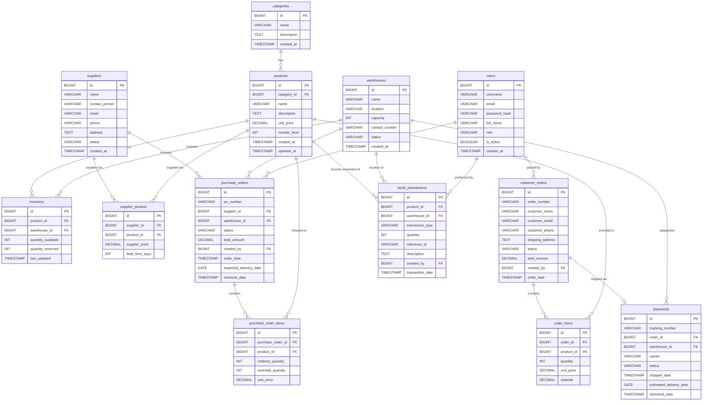

# 01 — Schema & ER Reference

## 1. Source of Truth: How the Schema Gets Created

### Profile: `h2` (Development — the one actually run)

File: `backend/src/main/resources/application-h2.properties`

```
spring.jpa.hibernate.ddl-auto=create-drop
```

**What this means:** Every time the Spring Boot app starts, Hibernate **drops all tables and re-creates them** from the JPA `@Entity` classes. The SQL files (`database/01_schema.sql`, `02_views_and_procedures.sql`, `03_seed_data.sql`) are **NOT run** in this profile — there is no `spring.sql.init.*` property set here. Data is seeded entirely by `DataInitializer.java` (a `CommandLineRunner`).

### Profile: Default / MySQL (Production target)

File: `backend/src/main/resources/application.properties`

```
spring.jpa.hibernate.ddl-auto=update
spring.datasource.url=jdbc:mysql://localhost:3306/smart_inventory_db
```

**What this means:** Hibernate only adds missing columns/tables — it does NOT drop and re-create. The SQL files are reference documentation and MySQL deployment scripts; they would be run manually to initialize a production MySQL database.

### Runtime Authority

**In H2 mode (the running app), the JPA `@Entity` classes are the sole authority** for the schema. The SQL files in `database/` describe the same design but differ in some details noted below.

---

## 2. Full Schema

### Differences: JPA Entities vs. SQL Files

| Aspect | SQL File says | JPA Entity says | Runtime (H2) uses |
|---|---|---|---|
| `users.role` | `ENUM('ADMIN','EMPLOYEE')` | `@Enumerated(EnumType.STRING)` → VARCHAR | **VARCHAR** (H2 has no ENUM; stored as string) |
| `suppliers.status` | `ENUM('ACTIVE','INACTIVE')` | plain `String` field, no `@Enumerated` | **VARCHAR** |
| `warehouses.status` | `ENUM('ACTIVE','INACTIVE')` | plain `String` field | **VARCHAR** |
| `shipments.status` | `ENUM('PREPARING','DISPATCHED','IN_TRANSIT','DELIVERED','DELAYED')` | `@Enumerated(EnumType.STRING)` | **VARCHAR** |
| `purchase_orders.status` | ENUM with 6 values | `@Enumerated(EnumType.STRING)` | **VARCHAR** |
| `customer_orders.status` | ENUM with 6 values | `@Enumerated(EnumType.STRING)` | **VARCHAR** |
| `stock_transactions.transaction_type` | ENUM with 6 values | `@Enumerated(EnumType.STRING)` | **VARCHAR** |
| `inventory` CHECK constraints | `chk_inv_qty_avail CHECK (qty >= 0)` | No `@Check` annotation | **NOT ENFORCED at DB level in H2** (enforced in service code) |
| `products` CHECK constraints | `chk_product_unit_price CHECK (unit_price >= 0)` | No `@Check` annotation | **NOT ENFORCED at DB level in H2** |
| `shipments.cancelled` status | NOT in SQL ENUM | `ShipmentStatus.CANCELLED` exists in Java enum | Only in Java — if persisted to MySQL would fail the ENUM constraint |

---

### Table 1: `users`

```sql
CREATE TABLE IF NOT EXISTS users (
    id            BIGINT AUTO_INCREMENT PRIMARY KEY,
    username      VARCHAR(50)  NOT NULL UNIQUE,
    email         VARCHAR(100) NOT NULL UNIQUE,
    password_hash VARCHAR(255) NOT NULL,
    full_name     VARCHAR(100) NOT NULL,
    role          ENUM('ADMIN','EMPLOYEE') NOT NULL DEFAULT 'EMPLOYEE',
    is_active     BOOLEAN NOT NULL DEFAULT TRUE,
    created_at    TIMESTAMP NOT NULL DEFAULT CURRENT_TIMESTAMP
) ENGINE=InnoDB;
```

| Column | Type | Constraint | Meaning |
|---|---|---|---|
| `id` | BIGINT | PK, AUTO_INCREMENT | Surrogate primary key |
| `username` | VARCHAR(50) | NOT NULL, UNIQUE | Login username |
| `email` | VARCHAR(100) | NOT NULL, UNIQUE | User email address |
| `password_hash` | VARCHAR(255) | NOT NULL | BCrypt-hashed password |
| `full_name` | VARCHAR(100) | NOT NULL | Display name |
| `role` | ENUM | NOT NULL, DEFAULT 'EMPLOYEE' | Either ADMIN or EMPLOYEE |
| `is_active` | BOOLEAN | NOT NULL, DEFAULT TRUE | Soft-disable flag |
| `created_at` | TIMESTAMP | NOT NULL, DEFAULT NOW() | Account creation time |

---

### Table 2: `categories`

```sql
CREATE TABLE IF NOT EXISTS categories (
    id          BIGINT AUTO_INCREMENT PRIMARY KEY,
    name        VARCHAR(100) NOT NULL UNIQUE,
    description TEXT,
    created_at  TIMESTAMP NOT NULL DEFAULT CURRENT_TIMESTAMP
) ENGINE=InnoDB;
```

| Column | Type | Constraint | Meaning |
|---|---|---|---|
| `id` | BIGINT | PK, AUTO_INCREMENT | Surrogate key |
| `name` | VARCHAR(100) | NOT NULL, UNIQUE | Category name (e.g., "Electronics & Scanners") |
| `description` | TEXT | nullable | Long description |
| `created_at` | TIMESTAMP | NOT NULL, DEFAULT NOW() | When category was created |

---

### Table 3: `products`

```sql
CREATE TABLE IF NOT EXISTS products (
    id            BIGINT AUTO_INCREMENT PRIMARY KEY,
    category_id   BIGINT NOT NULL,
    name          VARCHAR(150) NOT NULL,
    description   TEXT,
    unit_price    DECIMAL(10, 2) NOT NULL,
    reorder_level INT NOT NULL DEFAULT 10,
    created_at    TIMESTAMP NOT NULL DEFAULT CURRENT_TIMESTAMP,
    updated_at    TIMESTAMP NOT NULL DEFAULT CURRENT_TIMESTAMP ON UPDATE CURRENT_TIMESTAMP,
    CONSTRAINT fk_products_category FOREIGN KEY (category_id) REFERENCES categories(id) ON DELETE RESTRICT,
    CONSTRAINT chk_product_unit_price CHECK (unit_price >= 0),
    CONSTRAINT chk_product_reorder_level CHECK (reorder_level >= 0)
) ENGINE=InnoDB;

CREATE INDEX idx_products_category ON products(category_id);
```

| Column | Type | Constraint | Meaning |
|---|---|---|---|
| `id` | BIGINT | PK, AUTO_INCREMENT | Surrogate key |
| `category_id` | BIGINT | NOT NULL, FK → categories(id) RESTRICT | Which category this product belongs to |
| `name` | VARCHAR(150) | NOT NULL | Product display name |
| `description` | TEXT | nullable | Detailed description |
| `unit_price` | DECIMAL(10,2) | NOT NULL, CHECK ≥ 0 | Selling price per unit |
| `reorder_level` | INT | NOT NULL, DEFAULT 10, CHECK ≥ 0 | Alert threshold: when available stock ≤ this, it's "low stock" |
| `created_at` | TIMESTAMP | NOT NULL, DEFAULT NOW(), not updatable | Record creation time |
| `updated_at` | TIMESTAMP | NOT NULL, ON UPDATE CURRENT_TIMESTAMP | Last modification time |

> **Note:** SKU was removed. It does not exist in the entity or the modified SQL file.

**Index:** `idx_products_category (category_id)` — speeds up filtering products by category.

---

### Table 4: `suppliers`

```sql
CREATE TABLE IF NOT EXISTS suppliers (
    id             BIGINT AUTO_INCREMENT PRIMARY KEY,
    name           VARCHAR(150) NOT NULL,
    contact_person VARCHAR(100),
    email          VARCHAR(100) NOT NULL UNIQUE,
    phone          VARCHAR(20)  NOT NULL,
    address        TEXT,
    status         ENUM('ACTIVE', 'INACTIVE') NOT NULL DEFAULT 'ACTIVE',
    created_at     TIMESTAMP NOT NULL DEFAULT CURRENT_TIMESTAMP
) ENGINE=InnoDB;
```

| Column | Type | Constraint | Meaning |
|---|---|---|---|
| `id` | BIGINT | PK, AUTO_INCREMENT | Surrogate key |
| `name` | VARCHAR(150) | NOT NULL | Supplier company name |
| `contact_person` | VARCHAR(100) | nullable | Primary contact name |
| `email` | VARCHAR(100) | NOT NULL, UNIQUE | Contact email (also acts as business identifier) |
| `phone` | VARCHAR(20) | NOT NULL | Phone number |
| `address` | TEXT | nullable | Physical address |
| `status` | ENUM | NOT NULL, DEFAULT 'ACTIVE' | Whether the supplier is usable |
| `created_at` | TIMESTAMP | NOT NULL, DEFAULT NOW() | Record creation time |

---

### Table 5: `warehouses`

```sql
CREATE TABLE IF NOT EXISTS warehouses (
    id             BIGINT AUTO_INCREMENT PRIMARY KEY,
    name           VARCHAR(100) NOT NULL UNIQUE,
    location       VARCHAR(255) NOT NULL,
    capacity       INT NOT NULL,
    contact_number VARCHAR(20),
    status         ENUM('ACTIVE', 'INACTIVE') NOT NULL DEFAULT 'ACTIVE',
    created_at     TIMESTAMP NOT NULL DEFAULT CURRENT_TIMESTAMP,
    CONSTRAINT chk_warehouse_capacity CHECK (capacity > 0)
) ENGINE=InnoDB;
```

| Column | Type | Constraint | Meaning |
|---|---|---|---|
| `id` | BIGINT | PK, AUTO_INCREMENT | Surrogate key |
| `name` | VARCHAR(100) | NOT NULL, UNIQUE | Warehouse display name |
| `location` | VARCHAR(255) | NOT NULL | Physical address |
| `capacity` | INT | NOT NULL, CHECK > 0 | Max number of items (unit count) |
| `contact_number` | VARCHAR(20) | nullable | Phone number |
| `status` | ENUM | NOT NULL, DEFAULT 'ACTIVE' | Active/Inactive |
| `created_at` | TIMESTAMP | NOT NULL, DEFAULT NOW() | Record creation time |

---

### Table 6: `inventory`

```sql
CREATE TABLE IF NOT EXISTS inventory (
    id                 BIGINT AUTO_INCREMENT PRIMARY KEY,
    product_id         BIGINT NOT NULL,
    warehouse_id       BIGINT NOT NULL,
    quantity_available INT NOT NULL DEFAULT 0,
    quantity_reserved  INT NOT NULL DEFAULT 0,
    last_updated       TIMESTAMP NOT NULL DEFAULT CURRENT_TIMESTAMP ON UPDATE CURRENT_TIMESTAMP,
    CONSTRAINT fk_inventory_product   FOREIGN KEY (product_id)   REFERENCES products(id)   ON DELETE CASCADE,
    CONSTRAINT fk_inventory_warehouse FOREIGN KEY (warehouse_id) REFERENCES warehouses(id) ON DELETE CASCADE,
    CONSTRAINT uq_inventory_product_warehouse UNIQUE (product_id, warehouse_id),
    CONSTRAINT chk_inv_qty_avail     CHECK (quantity_available >= 0),
    CONSTRAINT chk_inv_qty_reserved  CHECK (quantity_reserved  >= 0)
) ENGINE=InnoDB;

CREATE INDEX idx_inventory_lookup ON inventory(product_id, warehouse_id);
```

| Column | Type | Constraint | Meaning |
|---|---|---|---|
| `id` | BIGINT | PK, AUTO_INCREMENT | Surrogate key |
| `product_id` | BIGINT | NOT NULL, FK → products(id) CASCADE | Which product |
| `warehouse_id` | BIGINT | NOT NULL, FK → warehouses(id) CASCADE | Which warehouse |
| `quantity_available` | INT | NOT NULL, DEFAULT 0, CHECK ≥ 0 | Units ready to sell |
| `quantity_reserved` | INT | NOT NULL, DEFAULT 0, CHECK ≥ 0 | Units held for confirmed orders |
| `last_updated` | TIMESTAMP | NOT NULL, ON UPDATE CURRENT_TIMESTAMP | Last stock change time |

**UNIQUE:** `(product_id, warehouse_id)` — one row per product per warehouse.  
**Index:** `idx_inventory_lookup (product_id, warehouse_id)` — fast lookup for the common query pattern.  
**Row Lock:** `InventoryRepository.lockByProductIdAndWarehouseId` applies `PESSIMISTIC_WRITE` lock during order confirmation.

---

### Table 7: `supplier_product` (Junction / M:N)

```sql
CREATE TABLE IF NOT EXISTS supplier_product (
    id             BIGINT AUTO_INCREMENT PRIMARY KEY,
    supplier_id    BIGINT NOT NULL,
    product_id     BIGINT NOT NULL,
    supplier_price DECIMAL(10, 2) NOT NULL,
    lead_time_days INT NOT NULL DEFAULT 7,
    CONSTRAINT fk_sp_supplier FOREIGN KEY (supplier_id) REFERENCES suppliers(id) ON DELETE CASCADE,
    CONSTRAINT fk_sp_product  FOREIGN KEY (product_id)  REFERENCES products(id)  ON DELETE CASCADE,
    CONSTRAINT uq_supplier_product UNIQUE (supplier_id, product_id),
    CONSTRAINT chk_sp_price     CHECK (supplier_price >= 0),
    CONSTRAINT chk_sp_lead_time CHECK (lead_time_days >= 0)
) ENGINE=InnoDB;
```

| Column | Type | Constraint | Meaning |
|---|---|---|---|
| `id` | BIGINT | PK, AUTO_INCREMENT | Surrogate key |
| `supplier_id` | BIGINT | NOT NULL, FK → suppliers(id) CASCADE | Which supplier |
| `product_id` | BIGINT | NOT NULL, FK → products(id) CASCADE | Which product |
| `supplier_price` | DECIMAL(10,2) | NOT NULL, CHECK ≥ 0 | Cost price from this supplier |
| `lead_time_days` | INT | NOT NULL, DEFAULT 7, CHECK ≥ 0 | Days from order to delivery |

**UNIQUE:** `(supplier_id, product_id)` — prevents duplicate supplier-product pairings.

---

### Table 8: `purchase_orders`

```sql
CREATE TABLE IF NOT EXISTS purchase_orders (
    id                     BIGINT AUTO_INCREMENT PRIMARY KEY,
    po_number              VARCHAR(50) NOT NULL UNIQUE,
    supplier_id            BIGINT NOT NULL,
    warehouse_id           BIGINT NOT NULL,
    status                 ENUM('PENDING','APPROVED','ORDERED','PARTIALLY_RECEIVED','RECEIVED','CANCELLED') NOT NULL DEFAULT 'PENDING',
    total_amount           DECIMAL(12, 2) NOT NULL DEFAULT 0.00,
    created_by             BIGINT NOT NULL,
    order_date             TIMESTAMP NOT NULL DEFAULT CURRENT_TIMESTAMP,
    expected_delivery_date DATE,
    received_date          TIMESTAMP NULL,
    CONSTRAINT fk_po_supplier FOREIGN KEY (supplier_id) REFERENCES suppliers(id) ON DELETE RESTRICT,
    CONSTRAINT fk_po_warehouse FOREIGN KEY (warehouse_id) REFERENCES warehouses(id) ON DELETE RESTRICT,
    CONSTRAINT fk_po_user     FOREIGN KEY (created_by)   REFERENCES users(id)      ON DELETE RESTRICT,
    CONSTRAINT chk_po_total_amount CHECK (total_amount >= 0)
) ENGINE=InnoDB;

CREATE INDEX idx_po_number ON purchase_orders(po_number);
```

| Column | Type | Constraint | Meaning |
|---|---|---|---|
| `id` | BIGINT | PK, AUTO_INCREMENT | Surrogate key |
| `po_number` | VARCHAR(50) | NOT NULL, UNIQUE | Human-readable ID, format `PO-N` |
| `supplier_id` | BIGINT | NOT NULL, FK → suppliers RESTRICT | Which supplier to buy from |
| `warehouse_id` | BIGINT | NOT NULL, FK → warehouses RESTRICT | Destination warehouse |
| `status` | ENUM | NOT NULL, DEFAULT 'PENDING' | Lifecycle stage |
| `total_amount` | DECIMAL(12,2) | NOT NULL, DEFAULT 0, CHECK ≥ 0 | Computed total cost |
| `created_by` | BIGINT | NOT NULL, FK → users RESTRICT | Admin who created it |
| `order_date` | TIMESTAMP | NOT NULL, DEFAULT NOW() | When PO was raised |
| `expected_delivery_date` | DATE | nullable | Planned delivery date |
| `received_date` | TIMESTAMP | nullable | When goods were marked received |

---

### Table 9: `purchase_order_items`

```sql
CREATE TABLE IF NOT EXISTS purchase_order_items (
    id                  BIGINT AUTO_INCREMENT PRIMARY KEY,
    purchase_order_id   BIGINT NOT NULL,
    product_id          BIGINT NOT NULL,
    ordered_quantity    INT NOT NULL,
    received_quantity   INT NOT NULL DEFAULT 0,
    unit_price          DECIMAL(10, 2) NOT NULL,
    CONSTRAINT fk_poi_order   FOREIGN KEY (purchase_order_id) REFERENCES purchase_orders(id) ON DELETE CASCADE,
    CONSTRAINT fk_poi_product FOREIGN KEY (product_id)        REFERENCES products(id)        ON DELETE RESTRICT,
    CONSTRAINT chk_poi_ordered_qty  CHECK (ordered_quantity > 0),
    CONSTRAINT chk_poi_received_qty CHECK (received_quantity >= 0),
    CONSTRAINT chk_poi_unit_price   CHECK (unit_price >= 0)
) ENGINE=InnoDB;
```

| Column | Type | Constraint | Meaning |
|---|---|---|---|
| `id` | BIGINT | PK, AUTO_INCREMENT | Surrogate key |
| `purchase_order_id` | BIGINT | NOT NULL, FK → purchase_orders CASCADE | Parent PO |
| `product_id` | BIGINT | NOT NULL, FK → products RESTRICT | Which product to order |
| `ordered_quantity` | INT | NOT NULL, CHECK > 0 | How many units ordered |
| `received_quantity` | INT | NOT NULL, DEFAULT 0, CHECK ≥ 0 | How many actually received (updated on RECEIVED) |
| `unit_price` | DECIMAL(10,2) | NOT NULL, CHECK ≥ 0 | Agreed price per unit at time of order |

---

### Table 10: `customer_orders`

```sql
CREATE TABLE IF NOT EXISTS customer_orders (
    id               BIGINT AUTO_INCREMENT PRIMARY KEY,
    order_number     VARCHAR(50) NOT NULL UNIQUE,
    customer_name    VARCHAR(150) NOT NULL,
    customer_email   VARCHAR(100) NOT NULL,
    customer_phone   VARCHAR(20),
    shipping_address TEXT NOT NULL,
    status           ENUM('PENDING','CONFIRMED','PROCESSING','SHIPPED','DELIVERED','CANCELLED') NOT NULL DEFAULT 'PENDING',
    total_amount     DECIMAL(12, 2) NOT NULL DEFAULT 0.00,
    created_by       BIGINT NOT NULL,
    order_date       TIMESTAMP NOT NULL DEFAULT CURRENT_TIMESTAMP,
    CONSTRAINT fk_co_user FOREIGN KEY (created_by) REFERENCES users(id) ON DELETE RESTRICT,
    CONSTRAINT chk_co_total_amount CHECK (total_amount >= 0)
) ENGINE=InnoDB;

CREATE INDEX idx_co_number ON customer_orders(order_number);
CREATE INDEX idx_co_status ON customer_orders(status);
```

| Column | Type | Constraint | Meaning |
|---|---|---|---|
| `id` | BIGINT | PK, AUTO_INCREMENT | Surrogate key |
| `order_number` | VARCHAR(50) | NOT NULL, UNIQUE | Format `ORD-DDMMYYYY-N` |
| `customer_name` | VARCHAR(150) | NOT NULL | Customer name |
| `customer_email` | VARCHAR(100) | NOT NULL | Customer email |
| `customer_phone` | VARCHAR(20) | nullable | Customer phone |
| `shipping_address` | TEXT | NOT NULL | Delivery address |
| `status` | ENUM | NOT NULL, DEFAULT 'PENDING' | Lifecycle stage |
| `total_amount` | DECIMAL(12,2) | NOT NULL, DEFAULT 0, CHECK ≥ 0 | Sum of line item subtotals |
| `created_by` | BIGINT | NOT NULL, FK → users RESTRICT | User who placed the order |
| `order_date` | TIMESTAMP | NOT NULL, DEFAULT NOW() | When order was placed |

---

### Table 11: `order_items`

```sql
CREATE TABLE IF NOT EXISTS order_items (
    id         BIGINT AUTO_INCREMENT PRIMARY KEY,
    order_id   BIGINT NOT NULL,
    product_id BIGINT NOT NULL,
    quantity   INT NOT NULL,
    unit_price DECIMAL(10, 2) NOT NULL,
    subtotal   DECIMAL(12, 2) NOT NULL,
    CONSTRAINT fk_oi_order   FOREIGN KEY (order_id)   REFERENCES customer_orders(id) ON DELETE CASCADE,
    CONSTRAINT fk_oi_product FOREIGN KEY (product_id) REFERENCES products(id)        ON DELETE RESTRICT,
    CONSTRAINT chk_oi_quantity   CHECK (quantity > 0),
    CONSTRAINT chk_oi_unit_price CHECK (unit_price >= 0),
    CONSTRAINT chk_oi_subtotal   CHECK (subtotal >= 0)
) ENGINE=InnoDB;
```

| Column | Type | Constraint | Meaning |
|---|---|---|---|
| `id` | BIGINT | PK, AUTO_INCREMENT | Surrogate key |
| `order_id` | BIGINT | NOT NULL, FK → customer_orders CASCADE | Parent order |
| `product_id` | BIGINT | NOT NULL, FK → products RESTRICT | Which product |
| `quantity` | INT | NOT NULL, CHECK > 0 | Units ordered |
| `unit_price` | DECIMAL(10,2) | NOT NULL, CHECK ≥ 0 | Price at time of order |
| `subtotal` | DECIMAL(12,2) | NOT NULL, CHECK ≥ 0 | quantity × unit_price |

---

### Table 12: `shipments`

```sql
CREATE TABLE IF NOT EXISTS shipments (
    id                     BIGINT AUTO_INCREMENT PRIMARY KEY,
    tracking_number        VARCHAR(50) NOT NULL UNIQUE,
    order_id               BIGINT NOT NULL,
    warehouse_id           BIGINT NOT NULL,
    carrier                VARCHAR(100) NOT NULL,
    status                 ENUM('PREPARING','DISPATCHED','IN_TRANSIT','DELIVERED','DELAYED') NOT NULL DEFAULT 'PREPARING',
    shipped_date           TIMESTAMP NULL,
    estimated_delivery_date DATE,
    delivered_date         TIMESTAMP NULL,
    CONSTRAINT fk_shipment_order     FOREIGN KEY (order_id)     REFERENCES customer_orders(id) ON DELETE RESTRICT,
    CONSTRAINT fk_shipment_warehouse FOREIGN KEY (warehouse_id) REFERENCES warehouses(id)      ON DELETE RESTRICT
) ENGINE=InnoDB;

CREATE INDEX idx_shipments_tracking ON shipments(tracking_number);
```

| Column | Type | Constraint | Meaning |
|---|---|---|---|
| `id` | BIGINT | PK, AUTO_INCREMENT | Surrogate key |
| `tracking_number` | VARCHAR(50) | NOT NULL, UNIQUE | Format `TRK-N` |
| `order_id` | BIGINT | NOT NULL, FK → customer_orders RESTRICT | Which order is being shipped |
| `warehouse_id` | BIGINT | NOT NULL, FK → warehouses RESTRICT | Dispatching warehouse |
| `carrier` | VARCHAR(100) | NOT NULL | Shipping carrier name |
| `status` | ENUM | NOT NULL, DEFAULT 'PREPARING' | Current shipment stage |
| `shipped_date` | TIMESTAMP | nullable | Set when status → DISPATCHED |
| `estimated_delivery_date` | DATE | nullable | Expected delivery date |
| `delivered_date` | TIMESTAMP | nullable | Set when status → DELIVERED |

> **Note:** Java enum has `CANCELLED` status (used in `ShipmentService.updateShipmentStatus`), but it is **NOT in the SQL ENUM definition**. This would fail on MySQL. In H2 it works fine since status is VARCHAR.

---

### Table 13: `stock_transactions`

```sql
CREATE TABLE IF NOT EXISTS stock_transactions (
    id               BIGINT AUTO_INCREMENT PRIMARY KEY,
    product_id       BIGINT NOT NULL,
    warehouse_id     BIGINT NOT NULL,
    transaction_type ENUM('STOCK_IN','STOCK_OUT','STOCK_TRANSFER','STOCK_ADJUSTMENT','STOCK_RESERVATION','STOCK_RELEASE') NOT NULL,
    quantity         INT NOT NULL,
    reference_id     VARCHAR(50),
    description      TEXT,
    created_by       BIGINT NOT NULL,
    transaction_date TIMESTAMP NOT NULL DEFAULT CURRENT_TIMESTAMP
    CONSTRAINT fk_st_product   FOREIGN KEY (product_id)   REFERENCES products(id)   ON DELETE RESTRICT,
    CONSTRAINT fk_st_warehouse FOREIGN KEY (warehouse_id) REFERENCES warehouses(id) ON DELETE RESTRICT,
    CONSTRAINT fk_st_user      FOREIGN KEY (created_by)   REFERENCES users(id)      ON DELETE RESTRICT
) ENGINE=InnoDB;

CREATE INDEX idx_stock_trans_type_date ON stock_transactions(transaction_type, transaction_date);
```

| Column | Type | Constraint | Meaning |
|---|---|---|---|
| `id` | BIGINT | PK, AUTO_INCREMENT | Surrogate key |
| `product_id` | BIGINT | NOT NULL, FK → products RESTRICT | Affected product |
| `warehouse_id` | BIGINT | NOT NULL, FK → warehouses RESTRICT | Affected warehouse |
| `transaction_type` | ENUM | NOT NULL | Type of movement |
| `quantity` | INT | NOT NULL | Units moved (can be negative for adjustments) |
| `reference_id` | VARCHAR(50) | nullable | PO number, order number, or adjustment ID |
| `description` | TEXT | nullable | Human-readable explanation |
| `created_by` | BIGINT | NOT NULL, FK → users RESTRICT | Who triggered the transaction |
| `transaction_date` | TIMESTAMP | NOT NULL, DEFAULT NOW() | When it happened |

**Index:** `idx_stock_trans_type_date (transaction_type, transaction_date)` — for filtering audit logs by type and date range.

---

## 3. ER Diagram



---

## 4. Relationships in Plain English

- One **category** has many **products** (a product belongs to exactly one category; deleting a category is RESTRICTED if products exist)
- One **product** has many **inventory** rows — one per warehouse where it is stocked
- One **warehouse** has many **inventory** rows — one per product stocked there
- **Suppliers** and **products** have a M:N relationship through the **`supplier_product`** junction table (one supplier can supply many products; one product can come from many suppliers)
- One **supplier** has many **purchase_orders** (a PO is from exactly one supplier)
- One **warehouse** receives many **purchase_orders**
- One **user** creates many **purchase_orders**
- One **purchase_order** has many **purchase_order_items** (line items)
- One **product** appears in many **purchase_order_items**
- One **user** creates many **customer_orders**
- One **customer_order** has many **order_items** (line items)
- One **product** appears in many **order_items**
- One **customer_order** has at most one **shipment** (1:0..1 relationship)
- One **warehouse** dispatches many **shipments**
- One **product** has many **stock_transactions** (audit trail of every stock movement)
- One **warehouse** appears in many **stock_transactions**
- One **user** triggers many **stock_transactions**

---

## 5. Views, Stored Procedures, Functions, Triggers

The SQL file `database/02_views_and_procedures.sql` defines the following. **None of them are called by any Java code** — they exist for direct MySQL reporting only. They are **NOT created** in H2 dev mode.

### VIEW 1: `vw_product_stock_overview`

```sql
CREATE OR REPLACE VIEW vw_product_stock_overview AS
SELECT
    p.id AS product_id,
    p.name AS product_name,
    c.id AS category_id,
    c.name AS category_name,
    p.unit_price,
    p.reorder_level,
    COALESCE(SUM(i.quantity_available), 0) AS total_available,
    COALESCE(SUM(i.quantity_reserved), 0) AS total_reserved,
    COALESCE(SUM(i.quantity_available + i.quantity_reserved), 0) AS total_physical_stock,
    (p.unit_price * COALESCE(SUM(i.quantity_available + i.quantity_reserved), 0)) AS total_inventory_value,
    CASE
        WHEN COALESCE(SUM(i.quantity_available), 0) = 0 THEN 'OUT_OF_STOCK'
        WHEN COALESCE(SUM(i.quantity_available), 0) <= p.reorder_level THEN 'LOW_STOCK'
        ELSE 'ADEQUATE'
    END AS stock_status
FROM products p
JOIN categories c ON p.category_id = c.id
LEFT JOIN inventory i ON p.id = i.product_id
GROUP BY p.id, p.name, c.id, c.name, p.unit_price, p.reorder_level;
```

**Step-by-step:** Joins products → categories (INNER), then LEFT JOIN inventory (LEFT so products with no stock row still appear). Groups per product and sums available + reserved stock across all warehouses. CASE expression classifies stock level. Useful for a dashboard showing all products with their stock health. **Java code: NOT CALLED.**

---

### VIEW 2: `vw_low_stock_alerts`

```sql
CREATE OR REPLACE VIEW vw_low_stock_alerts AS
SELECT
    p.id AS product_id,
    p.name AS product_name,
    c.name AS category_name,
    p.reorder_level,
    COALESCE(SUM(i.quantity_available), 0) AS current_available_stock,
    (p.reorder_level - COALESCE(SUM(i.quantity_available), 0)) AS deficit
FROM products p
JOIN categories c ON p.category_id = c.id
LEFT JOIN inventory i ON p.id = i.product_id
GROUP BY p.id, p.name, c.name, p.reorder_level
HAVING COALESCE(SUM(i.quantity_available), 0) <= p.reorder_level;
```

**Step-by-step:** Same structure as view 1 but uses `HAVING` to filter only products where total available stock is at or below the reorder level. `deficit` = how many units short. **Java code: NOT CALLED.** (Java uses `ProductRepository.findLowStockProducts()` which does its own query.)

---

### VIEW 3: `vw_warehouse_utilization`

```sql
CREATE OR REPLACE VIEW vw_warehouse_utilization AS
SELECT
    w.id AS warehouse_id, w.name AS warehouse_name, w.location, w.capacity,
    COALESCE(SUM(i.quantity_available + i.quantity_reserved), 0) AS current_item_count,
    ROUND((COALESCE(SUM(i.quantity_available + i.quantity_reserved), 0) / w.capacity) * 100, 2) AS utilization_percentage,
    COUNT(DISTINCT i.product_id) AS distinct_products_stored
FROM warehouses w
LEFT JOIN inventory i ON w.id = i.warehouse_id
WHERE w.status = 'ACTIVE'
GROUP BY w.id, w.name, w.location, w.capacity;
```

**Step-by-step:** For each active warehouse, sums all physical stock (available + reserved) and calculates what percentage of capacity is used. `COUNT(DISTINCT i.product_id)` counts unique product types stored. **Java code: NOT CALLED.**

---

### VIEW 4: `vw_supplier_order_summary`

```sql
CREATE OR REPLACE VIEW vw_supplier_order_summary AS
SELECT
    s.id, s.name, s.email, s.phone,
    COUNT(po.id) AS total_purchase_orders,
    COALESCE(SUM(po.total_amount), 0.00) AS total_spend,
    COALESCE(AVG(po.total_amount), 0.00) AS average_po_value,
    SUM(CASE WHEN po.status = 'PENDING' THEN 1 ELSE 0 END) AS pending_orders,
    SUM(CASE WHEN po.status = 'RECEIVED' THEN 1 ELSE 0 END) AS completed_orders
FROM suppliers s
LEFT JOIN purchase_orders po ON s.id = po.supplier_id
GROUP BY s.id, s.name, s.email, s.phone;
```

**Step-by-step:** Aggregates all purchase order activity per supplier — count, total money spent, average PO value, and counts broken down by status. **Java code: NOT CALLED.**

---

### VIEW 5: `vw_recent_order_activity`

```sql
CREATE OR REPLACE VIEW vw_recent_order_activity AS
SELECT
    co.id AS order_id, co.order_number, co.customer_name,
    co.status AS order_status, co.total_amount, co.order_date,
    COUNT(oi.id) AS total_items,
    sh.tracking_number, sh.carrier, sh.status AS shipment_status
FROM customer_orders co
LEFT JOIN order_items oi ON co.id = oi.order_id
LEFT JOIN shipments sh ON co.id = sh.order_id
GROUP BY co.id, co.order_number, co.customer_name, co.status,
         co.total_amount, co.order_date, sh.tracking_number, sh.carrier, sh.status;
```

**Step-by-step:** Joins customer orders with their items (to count them) and their shipment (LEFT JOIN so orders without a shipment still appear). Useful for an order management dashboard. **Java code: NOT CALLED.**

---

### STORED PROCEDURE 1: `sp_reserve_stock_for_order`

Accepts `p_order_id`, `p_warehouse_id`, `p_user_id` as IN params. Returns `p_status_code` and `p_message`.

**Step-by-step:**
1. `START TRANSACTION`
2. Checks the order exists and is PENDING; rolls back if not
3. Opens a cursor over `order_items` for the given order
4. **Phase A (validation loop):** For each item, `SELECT ... FOR UPDATE` (row-level lock) the inventory row; if stock < needed, ROLLBACK and return 422
5. **Phase B (deduction loop):** For each item, `UPDATE inventory` to deduct available and add to reserved; inserts a `STOCK_RESERVATION` row in `stock_transactions`
6. `UPDATE customer_orders SET status = 'CONFIRMED'`
7. `COMMIT`

> **Note:** This procedure has the same per-item (not aggregated) stock check as the original Java bug that was fixed. It has not been updated to reflect the fix. **Java code: NOT CALLED** — Java service does this directly with `@Transactional`.

---

### STORED PROCEDURE 2: `sp_receive_purchase_order`

**Step-by-step:**
1. `START TRANSACTION`
2. `SELECT ... FOR UPDATE` the PO to get `warehouse_id` and `status`
3. Validates PO exists and is in ORDERED/APPROVED/PENDING status
4. Loops over `purchase_order_items`: for each item, `INSERT INTO inventory ... ON DUPLICATE KEY UPDATE quantity_available += ordered_qty`; inserts a `STOCK_IN` transaction row; updates `received_quantity` on the PO item
5. `UPDATE purchase_orders SET status = 'RECEIVED', received_date = NOW()`
6. `COMMIT`

**Java code: NOT CALLED** — Java service handles this in `PurchaseOrderService.updateStatus`.

**Triggers:** NOT PRESENT in any file.  
**Functions:** NOT PRESENT in any file.

---

## 6. Normalization

| Table | Normal Form | Reasoning |
|---|---|---|
| `users` | 3NF | PK → all columns; no transitive dependencies |
| `categories` | 3NF | PK → name, description; no transitive deps |
| `products` | 3NF | PK → all columns; `category_id` FK prevents repeating category data |
| `suppliers` | 3NF | PK → all columns |
| `warehouses` | 3NF | PK → all columns |
| `inventory` | 3NF | Composite business key `(product_id, warehouse_id)` promoted to PK surrogate; quantities depend only on the PK |
| `supplier_product` | 3NF | Junction table resolving M:N; `supplier_price` and `lead_time_days` are facts about the relationship, not about supplier or product alone |
| `purchase_orders` | 3NF | PK → all columns; supplier/warehouse data lives in their own tables |
| `purchase_order_items` | 3NF | Each line item's `unit_price` is the agreed price at order time — **deliberate denormalization** vs. `products.unit_price`. This is correct: products prices can change but the PO item price must not. |
| `customer_orders` | 3NF | Same reasoning as purchase_orders |
| `order_items` | 3NF | `unit_price` and `subtotal` are **deliberate denormalizations** — price snapshot at order time; `subtotal = quantity × unit_price` is a computed redundancy for query performance |
| `shipments` | 3NF | PK → all columns |
| `stock_transactions` | 3NF | Immutable audit log; each row is a fact about one event. No updates ever made to these rows |

**Deliberate denormalizations:**
- `order_items.unit_price` and `purchase_order_items.unit_price` store the price at time of order rather than always referencing `products.unit_price`. This is intentional — prices change over time, orders must be frozen.
- `order_items.subtotal` stores `quantity × unit_price` redundantly to avoid recomputing it on every read.
- `customer_orders.total_amount` and `purchase_orders.total_amount` are computed aggregates stored directly — again for read performance.

---

## 7. Seed Data

### Source
- **H2 profile:** `DataInitializer.java` (runs on every startup via `CommandLineRunner`, inserting only if tables are empty)
- **MySQL profile:** `database/03_seed_data.sql` (run manually; uses `ON DUPLICATE KEY UPDATE`)

### Default Login Users (both profiles)

| Username | Password | Role |
|---|---|---|
| `admin` | `admin123` | ADMIN |
| `employee` | `employee123` | EMPLOYEE |

### Example Rows — DataInitializer (H2)

**Categories (5 rows):**

| id | name |
|---|---|
| 1 | Electronics & Scanners |
| 2 | Warehouse Equipment |
| 3 | Packaging Materials |
| 4 | Raw Materials |
| 5 | Safety & PPE |

**Warehouses (3 rows):**

| id | name | location | capacity |
|---|---|---|---|
| 1 | Central Distribution Hub | 7500 S Pulaski Rd, Chicago, IL | 50000 |
| 2 | West Coast Facility | 1240 6th Ave S, Seattle, WA | 35000 |
| 3 | East Coast Logistics Center | 200 Port Terminal Blvd, Elizabeth, NJ | 40000 |

**Products (2 rows — DataInitializer only seeds 2; SQL seeds 10):**

| id | name | unit_price | reorder_level |
|---|---|---|---|
| 1 | Handheld 2D Barcode Scanner | 89.99 | 15 |
| 2 | Industrial Thermal Label Printer | 249.50 | 10 |

**Inventory (H2 seeds 2 rows):**

| product_id | warehouse_id | qty_available | qty_reserved |
|---|---|---|---|
| 1 | 1 | 45 | 5 |
| 2 | 1 | 8 | 2 |

**Customer Orders (H2 seeds 2):**

| order_number | customer_name | status | total_amount |
|---|---|---|---|
| ORD-19112026-1 | Acme Logistics Inc. | CONFIRMED | 449.95 |
| ORD-19112026-2 | Summit Retail Solutions | PENDING | 249.50 |

**Shipments (H2 seeds 1):**

| tracking_number | carrier | status |
|---|---|---|
| TRK-1 | BlueDart Express | PREPARING |

> **Note:** The SQL seed file seeds considerably more data (4 suppliers, 10 products, 23 inventory rows, 4 POs, 4 customer orders, 3 shipments, 10 stock transactions). This is used for MySQL deployment only.
